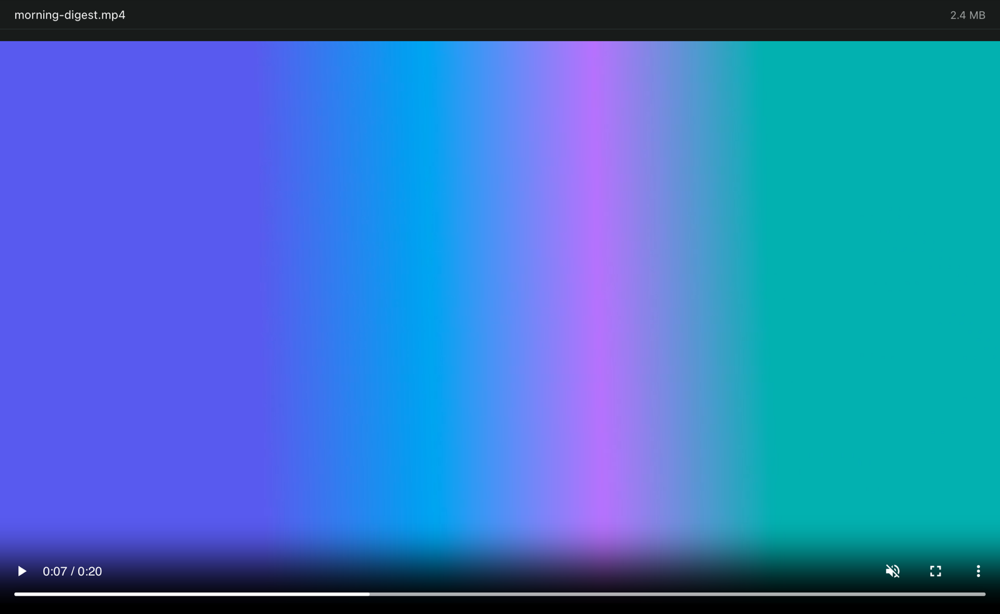

# 🎬 Video player for Paseo

Click a video in Paseo and it plays in the tab, with no more **"Binary preview unavailable"**.

I built this because my automations (a daily digest, explainer videos for PRs) render MP4s, and I wanted to watch them right where the agent made them.

<p align="center">
  
</p>

## What you get

- ▶️ **Plays in place.** Open an `.mp4`, `.m4v`, `.mov`, `.webm` or `.ogv` from the file explorer and it just plays.
- 🎛️ **Normal controls.** Seek, volume, speed, picture in picture and full screen.
- 🔖 **Remembers your spot.** Close the tab, come back later, and pick up where you left off.
- 🔄 **Follows the file.** If an agent re-renders the video, the tab reloads it and keeps your position.
- 🔒 **Nothing leaves your machine.** It runs only in the app, with no backend and no network calls.

## Install

In Paseo, open **Settings → Plugins** and add:

```
git:Prithpal-Sooriya/paseo-plugin-video-player
```

Or from a terminal:

```bash
paseo plugin install git:Prithpal-Sooriya/paseo-plugin-video-player
```

You'll need Paseo 0.13 or newer, with plugins turned on in **Settings → Plugins**.

## Good to know

- The whole file loads before playback starts, so a big video on a remote host takes a moment to open.
- H.264 MP4s play everywhere. HEVC, AV1 and some MOV files depend on your operating system.
- On iOS and Android it uses the system player and doesn't remember your position yet.

## Hacking on it

```bash
npm install
npm run check                                 # typecheck, mobile safety, package contents
paseo plugin install "$PWD"                   # install your local copy
paseo plugin reload video-player              # after each change
```

The plugin is a single [file panel](https://paseo.sh/docs/plugins/reference#file-panels): `client/video-panel.tsx` renders it, and `client/web.ts` mounts the HTML5 `<video>` element on desktop and web.

### Releasing

Bump the version in a PR (`npm version minor --no-git-tag-version`), merge it, then tag the merged commit:

```bash
git tag v0.2.0 && git push origin v0.2.0
```

The [release workflow](.github/workflows/release.yml) checks that the tag matches `package.json`, then publishes a GitHub release with notes. A tag like `v0.2.0-beta.1` becomes a pre-release.

## License

MIT
